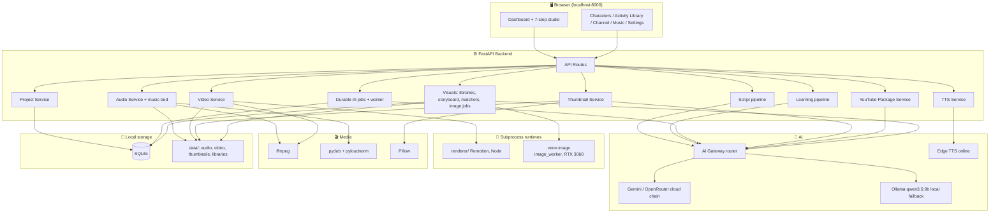
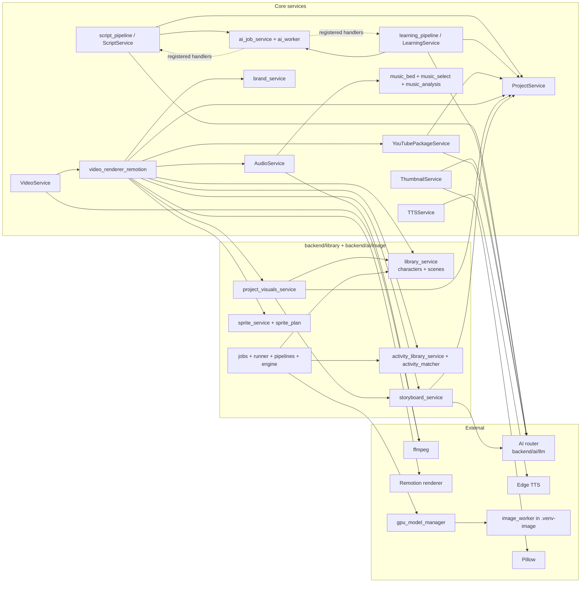

# ARCHITECTURE.md — Daily Beyond English Studio (Daily Intel English)

<!-- crystallize_version: 0.8.0 -->

## Current speech policy - Phase 77 (2026-10-24)

The owner retired emotion insertion and local speech engines after the listening trials. Scripts now contain plain dialogue, and Edge TTS is the only selectable/dispatchable speech engine. Migration040 strips recognized old directions, normalizes stored engines and invalidates affected media without deleting last-good files. The Edge catalogue and native word timestamps remain. The Chatterbox aligner and 120ms audition delay were never integrated. See [Phase 77](phases/77-edge-plain-speech/PLAN.md).

## Architecture extension — Phase 76: Topic project output folders

`project_exports` keeps the checked output components per project and an explicit `layout_mode`. Existing rows migrate as `legacy` and continue using their saved destination. New or opted-in projects use `topic_export_roots` to remember a shared parent folder keyed by Channel Plan Topic ID or normalized standalone Topic text. Their saved `relative_dir` fixes the resolved project folder so a later same-name project cannot displace it. The export service resolves Channel Plan episodes as Topic / Series / `Ep NN - title` and standalone projects as project Topic / project name. Existing sync hooks still copy checked deliverables outside the database transaction; changing a root never moves or deletes old files. The shared panel in Step 1 and Step 7 previews the server-resolved destination through the export API. See [Phase 76](phases/76-topic-project-folders/PLAN.md) and [operator guide](../docs/operations/topic-project-folders.md).

*Source snapshot2026-10-16: Phase47 captions, Phase48 voices and Phase49.1–49.9 are technically verified;49.10 code/package checks are verified, with the real-art demonstration and owner V49 acceptance pending. Published trial remains1.4.0-rc.1; last stable1.3.0. The published ZIP predates these source additions. Phase51 separately tracks the local Desktop correction; consult its actual installation evidence.*

## Historical Phase 74/75 speech experiments - retired

Phase 74's AI cue annotation and prosody recipes and Phase 75's optional local engine are superseded by the owner's Phase 77 decision. Their original plans/listening reports are historical; they do not describe the current product.

## Architecture extension — Phase48/49: current source and remaining plan

Source of truth: [SPEC](SPEC.md), [PLAN](PLAN.md), [Phase49 state](phases/49-solo-explainer/PHASE-STATE.md). The overview below describes the base application. Extension status is:

- **Verified Phase48:** Edge TTS catalog + independent audition cache; pinned profile/project voice IDs, TTS fingerprints and targeted stale propagation. No new TTS engine.
- **Verified49.1/49.4:** `presentation_mode=classic|solo_explainer`, default classic; one-presenter Why/How/List script generation/repair with CEFR budgets. Migration027 is atomic per SQL file and was verified on disposable legacy copies; Phase51 separately records the authorized owner backup/local Desktop upgrade.
- **Verified49.2/49.3:** independent native29/front21 packs, external-AI prompt/reference → import/review UI, immutable manifests with pinned versions and hashes. Real Hoang front21 art is still pending.
- **Verified49.5a/b:** immutable project illustrations, exact end-exclusive script-token coverage, actual audio-word mapping and migration028 preserving durable jobs/checkpoints; source/revision CAS, immutable plan history, owner locks, bounded proposal/repair worker and approval snapshot pinning.
- **Verified49.6/49.7:** safe16:9/9:16 geometry using real alpha/motion bounds; serialized layout edits, photo/diagram/card editing, migration029 and embedded Remotion Player. Preview, production and StillFrame share `SoloScene`; Player transport sits outside the picture. Build `npm --prefix renderer run build:preview` before frozen packaging; its output is generated/ignored.
- **Verified49.8/49.9:** immutable approved media pins, actual word-timed Solo production, guarded render publication, Shorts, composed thumbnails, series/copy/export and monologue publishing text. Owner-source changes invalidate stale approval/media.
- **49.10 implementation verified:** two frozen fixture launches, real Player/StillFrame comparisons and decoded landscape/portrait/SRT outputs. Real Hoang front21 art and explicit V49 acceptance remain pending; the owner confirmed no real pictures are available yet. The21 upload cards and strict outside-AI prompts are implemented.
- **Phase51 runtime recovery:** `/api/system/build` identifies the serving build/data instance without returning paths. The Desktop launcher only reuses matching instances. The installer checks unfinished jobs and takes consistent SQLite backups before replacing the exact installed process/distribution; local trial installation evidence is separate from publication.

Native packs and existing outputs are retained. Source verification and owner acceptance remain separate; Phase47 visual review, V49 and B-25/B-26/B-27/B-28 remain pending. Task50.1 addresses cancellation rollback in the shared DB helper; Phase50 does not change the connection architecture.

## System Overview

Daily Beyond English Studio là một **local web application** chạy trên `http://localhost:8000`. Backend Python FastAPI xử lý toàn bộ logic AI, TTS, audio/video và hình ảnh. Frontend HTML/CSS/JS thuần túy giao tiếp với backend qua REST API. Hai môi trường phụ chạy như tiến trình con, tách khỏi venv chính: Node.js `renderer/` (Remotion) và `.venv-image` (image worker trên GPU).

```
Browser (localhost:8000)
        ↕ REST API (synchronous, polling — no WebSocket/SSE anywhere in the app)
FastAPI Backend (Python 3.11+)
        ├── AI Gateway (backend/ai/llm/) — cloud-first (Phase 18, D21/D31):
        │     Gemini 3.1 Flash-Lite → Gemini Flash-Lite latest → OpenRouter free
        │     (Nemotron → Gemma 4 → Dots3) → local Ollama qwen3.5:9b;
        │     kill switch DIE_AI_ALLOW_CLOUD=false / DIE_AI_MODE=local
        ├── Durable AI jobs + in-process worker (script, learning, storyboard)
        ├── Edge TTS (only speech engine, online)
        ├── pydub + ffmpeg + pyloudnorm (audio mix, smart music bed)
        ├── Video: Remotion subprocess (the only renderer since Phase 35)
        ├── Visuals (backend/library/): character/scene/sprite/activity
        │     libraries, storyboard, matchers, durable image jobs
        │     → backend/ai/image/image_worker.py in .venv-image (diffusers, Qwen-Image; Phase 44 removed SDXL)
        │       behind one GPU arbiter (gpu_model_manager)
        ├── Pillow (thumbnail generation)
        └── SQLite (aiosqlite, numbered migrations in backend/db/migrations/)
```

**TTS note:** One normal Edge request per spoken line provides audio and native word timestamps. Saved English voices and speed/pitch/volume are retained. Recognized retired directions are stripped rather than synthesized. See [plain Edge speech](../docs/operations/edge-plain-speech.md).

## ViePilot Organization Context

profile_id: none / not configured

---

## Diagram Applicability Matrix

| Diagram Type | Status | Rationale | Diagram source |
|---|---|---|---|
| system-overview | required | Local web app with two subprocess runtimes (Remotion, image worker) | .viepilot/architecture/system-overview.mermaid |
| data-flow | required | 7-step pipeline plus the visual libraries feeding Step 5 | .viepilot/architecture/data-flow.mermaid |
| event-flows | N/A | No event-driven flows anywhere in the app — all routes are synchronous REST, and job/status progress is a plain polling GET, not WebSocket/SSE (corrected 2026-09-18) | — |
| module-dependencies | required | Services graph | .viepilot/architecture/module-dependencies.mermaid |
| deployment | N/A | Local only, no cloud deployment (packaged as a Windows folder build via PyInstaller) | — |
| user-use-case | optional | Single user, use cases straightforward; omitted | — |

---

## System Overview Diagram

> Diagram source: .viepilot/architecture/system-overview.mermaid



---

## Data Flow Diagram (7-Step Pipeline)

> Diagram source: .viepilot/architecture/data-flow.mermaid

```mermaid
flowchart LR
    A([▶ New Project]) --> B

    subgraph B["Step 1: Config"]
        B1[Topic, CEFR, duration]
        B2[Speakers, accent, genre]
    end

    subgraph C["Step 2: AI Script"]
        C1[AI Gateway\ncloud-first, local fallback]
        C2[Section budget + repairs]
        C3[Inline editor]
    end

    subgraph D["Step 3: Learning Content"]
        D1[Vocabulary, idioms, grammar, quiz]
    end

    subgraph E["Step 4: TTS Audio Studio"]
        E1[Edge TTS per line\n+ per-word timings]
        E2[Mix + loudness\n+ smart music bed]
    end

    subgraph F["Step 5: Video Studio"]
        F1[Storyboard beats\nowner review]
        F2[Insert illustrations: Activity Library\nor local Qwen, no cast face]
        F3[Picture mode: talking sprites,\none still, black\n+ activity cutaways]
        F4[Remotion render\n+ SRT]
    end

    subgraph G["Step 6: Thumbnail"]
        G1[Composed, outside-AI or local Qwen scene\n+ headline, badges and logo]
    end

    subgraph H["Step 7: YouTube Package"]
        H1[Titles, description, tags,\nmeasured chapters, music credit]
        H2[.zip + selected component exports\nto the episode folder]
    end

    subgraph L["Libraries (standalone pages)"]
        L1[Characters + scenes]
        L2[Scene backgrounds]
        L3[Sprites + Activity Library]
        L4[Music Library]
    end

    B --> C --> D --> E --> F --> G --> H
    L1 & L2 & L3 --> F
    L4 --> E
    H --> I([📦 Ready for YouTube])
```



---

## Module Dependencies

> Diagram source: .viepilot/architecture/module-dependencies.mermaid



---

## Services Definitions

Sections 1–8 are the original core services; each now calls the cloud-first AI Gateway (section 9). Sections 9–14 cover Phases 13–32.

### 1. ScriptService (`backend/content/script_service.py`, `script_pipeline.py`)
- **Responsibility:** Generate podcast script via the AI Gateway (cloud-first, local fallback) as a durable, checkpointed job (section-by-section budget, repetition and global length repairs)
- **Inputs:** topic, CEFR level, duration, num_speakers, genre, accent, language_features
- **Outputs:** Structured script JSON (speaker, line, timing_estimate, language_notes)
- **Key logic:** CEFR-calibrated prompt templates, per-genre prompt, language feature toggles
- **Re-generate:** per-segment regeneration support

### 2. LearningContentService (`backend/content/learning_service.py`)
- **Responsibility:** Generate vocabulary, idioms, grammar notes, and comprehension questions via the AI Gateway as a durable job (`learning_pipeline.py`) with strict structured JSON schema
- **Inputs:** project script lines, CEFR level, topic
- **Outputs:** Structured learning pack JSON (`LearningPackOut`: vocabulary with IPA and bilingual definitions, idioms, grammar points, quiz questions with answer keys)
- **Key logic:** Structured JSON schema validation (`responseSchema`), fallback handling, SQLite persistence with UPSERT
- **Storage:** `learning_contents` table in SQLite

### 3. TTSService (`backend/ai/tts/tts_service.py`)
- **Responsibility:** Convert script lines → audio files per speaker
- **Engine:** Edge TTS only (free, online). Edge `WordBoundary` events provide native per-word timestamps. No inline emotion synthesis or local speech-engine selection.
- **Outputs:** Per-line WAV/MP3 files in `data/tts_cache/`
- **Voice mapping:** Each speaker → accent + gender → a concrete Edge TTS neural voice
  (`EDGE_TTS_VOICE_MAP`), plus speed/pitch/volume settings

### 4. AudioService (`backend/media/audio_service.py`) — Sub-task 1.6b, DONE
- **Responsibility:** Mix per-speaker audio lines → final podcast audio. Only processes
  already-synthesized audio (never calls a TTS engine itself — that split is deliberate).
- **Operations:**
  - Concatenate lines in `line_index` order with silence gaps (`SILENCE_SAME_SPEAKER_MS`
    same-speaker, `SILENCE_DIFFERENT_SPEAKER_MS` different-speaker)
  - Normalize integrated loudness to `TARGET_LOUDNESS_LUFS` via real ITU-R BS.1770
    measurement (`pyloudnorm`), gain-clamped so near-silent input can't be over-boosted
  - Add background music from `data/music_library/` (optional, filename passed per
    generate-call — no project-level "selected track" column yet): looped/trimmed to the
    mix's duration and capped at a **flat** `MUSIC_DUCKING_MAX_DBFS` ceiling for its whole
    length in the original Phase 1 design. **Superseded by Phase 22 (D51):** `music_bed.py` fits the
    track to the episode (crossfade loop), ducks it under speech, carries it over the intro/outro and
    fades it to silence; `music_select_service.py` auto-selects a track by topic, length and pace
  - Export MP3 (192kbps) + WAV (44100Hz 16-bit) to `data/audio_output/{project_id}/`
  - Advances `projects.status` to `audio_generated`, but only when the current status is
    exactly `script_generated` (best-effort — a later re-mix doesn't fight the forward-only
    state machine)
- **Timestamps:** Real per-line start/end seconds (measured, not estimated) persisted to
  `audio_jobs.timestamps_json` — this becomes the real source for YouTube chapters once
  Sub-task 1.9b consumes it (1.9a still estimates chapters from word count only, since no
  audio existed yet at that time)

### 5. VideoService (`backend/media/video_service.py`) — Sub-task 1.7a, DONE
- **Responsibility:** Generate podcast video (MP4). Only processes an already-completed
  audio mix from AudioService (Task 1.6) — never generates audio itself.
- **Renderer:** Remotion only (Phase 35, Task 35.5, D89 — the Standard ffmpeg renderer, its background templates, the
  9:16 blur-pad export, the `DIE_VIDEO_RENDERER` kill switch and the silent fallback were removed). Karaoke captions,
  speaker chips, vocabulary cards, chapter bar, branded intro/outro and the picture modes of Phases 20–33. See section 11.
  - `renderer_problem()` names what is missing (Node.js, `renderer` packages, Chrome Headless Shell) before any work;
    a failed render fails the job with Remotion's reason.
  - LivePortrait lip-sync was never implemented; Phase 32 talking sprites took its place. Speaker avatar uploads were
    removed in Task 35.4: a speaker's picture is its cast character's.
- **Output:** MP4 1280x720 + SRT (shifted by the intro). Remotion also renders 1080x1920 vertical episodes and approved highlight clips (Phases 37/42).

### 6. ThumbnailService (`backend/media/thumbnail_service.py`)
- **Responsibility:** Generate the episode's YouTube thumbnails (Phase 36, Tasks 36.3/36.4, D90–D92)
- **Kinds:** `composed` — `thumbnail_compose` draws the two main cast characters cut from their approved talking sprites
  (the video's placement and mirroring) over an Activity Library picture the storyboard uses, else a scene plate, else
  the brand gradient, with a Montserrat headline, CEFR/episode badges and the logo; `outside_ai` — the owner's picture
  made from the episode prompt (`GET .../thumbnails/outside-prompt`), with only the text, badges and logo added.
- **Pipeline:** AI Gateway headline/palette suggestions (renamed fields normalized) → Pillow composition → 3-5 variants;
  the composition inputs live in each variant's `render.json` so an edit re-renders the same picture.
- **Output:** PNG/JPG 1280x720 + 720x1280

### 7. YouTubePackageService (`backend/content/youtube_service.py`) — Sub-tasks 1.9a + 1.9b, DONE
- **Responsibility:** Generate YouTube upload metadata and assemble the final downloadable
  package.
- **Output (`youtube_packages` table, `003_youtube_package.sql` + `004_youtube_chapters_measured.sql`):**
  - 3 AI-generated title options (AI Gateway, cloud-first): `click_worthy`, `educational`, `seo` variants
  - AI-generated video description (AI Gateway, cloud-first)
  - Chapters: **measured** from AudioService's real per-line timestamps once a project's
    audio has been mixed (Task 1.6/1.7), otherwise **estimated** from cumulative script
    word count at a fixed reading speed (`YOUTUBE_CHAPTER_WORDS_PER_MINUTE`) for a project
    with no audio yet — `chapters_estimated` on the row/API response says which, and the
    UI shows the correct label rather than always claiming "estimated"
  - Tags & keywords (SEO), comma-joined, capped at `YOUTUBE_TAGS_MAX_CHARS`
- **Full `.zip` export (Sub-task 1.9b, `GET .../youtube/export`):** streams an in-memory
  zip containing `video.mp4` + `subtitles.srt` (from the completed `video_jobs` row, Task
  1.7) + `thumbnail.png` (the selected favorite, Task 1.8) + `metadata.txt` (titles,
  description, tags, chapters as plain text). Requires all three prerequisites to exist;
  a clear error names exactly which is missing. Full transcript/vocabulary/grammar/
  comprehension formatting in the export is not implemented (not part of the ROADMAP
  acceptance criterion, which only asks for video+thumbnail+SRT+metadata.txt).
- **Format:** Markdown + plain text for easy copy-paste

### 8. ProjectService (`backend/content/project_service.py`)
- **Responsibility:** CRUD for projects, auto-save, state machine
- **State machine:** `draft → script_generated → audio_generated → video_generated → complete`
- **Storage:** SQLite (aiosqlite)

---

### 9. AI Gateway (`backend/ai/llm/`) and durable AI jobs — Phases 13–18
- `router.py`: `AI_MODE` selection (`cloud_first` default, `local` kill switch), bounded per-provider
  retry with backoff, per-provider circuit breaker and time budget, ordered fallback chain
  Gemini 3.1 Flash-Lite → Gemini Flash-Lite latest → OpenRouter free models → Ollama `qwen3.5:9b`.
- Providers: `openai_compat_provider.py` (Gemini, OpenRouter and optional OpenCode Zen through one
  OpenAI-compatible client, order from `CLOUD_PROVIDER_ORDER`),
  `ollama_provider.py`, `fake_provider.py` (tests). `validation.py` parses and validates JSON output.
- `ai_job_service.py` + `ai_worker.py`: durable `ai_generation_jobs` rows with checkpoints; the in-process
  worker dispatches to handlers registered by the script and learning pipelines, so a crash resumes.

### 10. Visual libraries and pipelines (`backend/library/`) — Phases 20, 23, 24, 28, 29, 31, 32
- `library_service.py`: global Character and Scene libraries (55 places) with safe content paths.
- `project_visuals_service.py`: a project's cast and ordered scenes.
- `storyboard_service.py`: AI-proposed story beats, validated against the project, owner-reviewed in Step 5.
- Phase 44 removed project shots, the two-person Shot Library and its SDXL checks. Inserts use approved
  Activity Library pictures or generic Qwen illustrations; the cast is rendered from profile sprites.
- `sprite_service.py` + `sprite_plan.py`: talking-sprite sets per character and the per-line plan
  (face, gesture, mouth open/closed from speech loudness).
- `activity_library_service.py` + `activity_matcher.py`: review-gated activity pictures (generic or per
  character, owner-entered name per image) and the deterministic matcher for storyboard insert beats,
  with per-render usage history.
- `jobs.py`, `runner.py`, `pipelines.py`, `engine.py`, `recipes.py`: persistent FIFO image jobs (scene pictures, activity
  illustrations) run one at a time against `backend/ai/image/image_worker.py` in `.venv-image` (Qwen only since Phase 44);
  `IMAGE_ENGINE=fake` gives a deterministic GPU-free engine for tests.

### 11. Remotion renderer (`backend/media/video_renderer_remotion.py`, `renderer/`) — Phase 19+
- Builds the composition props (timings, captions, cast, storyboard scenes, sprites, activity cutaways,
  brand intro/outro, music) and runs the Node `renderer/` workspace (Remotion 4, React 19,
  TypeScript, Vitest) as a local subprocess. Nothing per-episode leaves the machine (invariant 37).
- The only renderer since Task 35.5 (invariant 36 is retired: there is no ffmpeg fallback any more).

### 12. GPU arbiter (`backend/ai/image/gpu_model_manager.py`) — Task 20.1
- An arbiter, not a loader: each GPU consumer (image worker, local Ollama fallback) takes an exclusive
  lease on the single RTX 3060, loads and unloads its own model inside it, and hands the card back.

### 13. Music (`music_library_service.py`, `music_analysis.py`, `music_select_service.py`, `music_bed.py`) — Phase 22
- Library upload and details (licence, credit), automatic pace/BPM/mood classification, auto-select with
  a guard-railed AI pick, the fitted and ducked bed, and the credit line in the YouTube description.

### 14. Brand (`brand_service.py`) — Phases 25, 27
- The Daily Beyond English intro/outro voice lines, cached as Edge TTS audio for the Enhanced video.

---

## Technology Decisions

| Decision | Choice | Rationale |
|---|---|---|
| Backend framework | FastAPI | Async, fast, auto OpenAPI docs, Python ecosystem |
| Frontend | Vanilla HTML/CSS/JS | Nhẹ, không dependency, dễ maintain |
| AI engine | Cloud-first gateway with local fallback (Phase 18, D21/D31) | Gate B-11: ~45 s median B1 script vs ~127 s local; `DIE_AI_ALLOW_CLOUD=false` / `DIE_AI_MODE=local` forces 100% offline Ollama `qwen3.5:9b` |
| TTS engine | Plain Edge TTS only (Phase 77) | Owner retired emotion insertion/local speech engines after listening trials on 2026-10-24 |
| Audio processing | pydub + ffmpeg + pyloudnorm | Mature; real ITU-R BS.1770 loudness |
| Video generation | Remotion (the only renderer since Phase 35) | Animated learning video (karaoke, cards, sprites); one renderer, no overlapping fallback (D89) |
| Images | diffusers 0.41 in `.venv-image`: Qwen-Image-2.1-Turbo (illustrations, plates, topic pictures), Phase 39; Qwen-Image-Edit-2511 (AI-scene thumbnails), Phase 43; RealVisXL/SDXL removed in Phase 44 (D123) | Local GPU, isolated heavy dependencies; the benchmark (`docs/operations/phase39-image-benchmark.md`) chose per task; libraries reuse approved pictures to save GPU time |
| Lips-sync | Not implemented; talking sprites (Phase 32) instead | No GPU time per episode, owner-made sprite sets |
| Thumbnail | Pillow composition of the cast sprites + episode pictures | Consistent branding, no API cost, user-editable |
| Database | SQLite (aiosqlite) | Zero-config, single-user, sufficient performance |
| Storage | Local filesystem | Simple, offline-first, no cloud dependency |

---

## API Endpoints

The endpoint list is generated from the live FastAPI schema into [`docs/api.md`](../docs/api.md)
(`scripts/generate_api_docs.py`; 128 routes on 2026-10-12) and served at `/docs` while the app runs.
It is no longer copied here by hand, so it cannot drift.

---

## Data Models

### Project
```json
{
  "id": "uuid",
  "name": "My Podcast Episode",
  "status": "draft|script_generated|audio_generated|video_generated|complete",
  // Forward-only: normally advances one step at a time (project_service.py::
  // _validate_status_transition), enforced on the public PUT /api/projects/{id}
  // endpoint. Two internal-only exceptions downgrade status back to
  // script_generated when a later step's output may no longer match: (1) editing
  // the script (generate/regenerate/manual save) while status is already past
  // script_generated (Task 7.1, mark_script_changed()); (2) editing a speaker's
  // voice settings (engine/description/speed/pitch/volume) while status is
  // audio_generated/video_generated/complete (Task 9.1, mark_speaker_voice_changed()).
  // Both are non-destructive -- no audio/video files or job records are deleted,
  // only the status signal changes. Neither downgrade fires at draft or
  // script_generated, so the normal Step 1/2 editing flow is unaffected.
  "config": {
    "topic": "string",
    "cefr_level": "A1|A2|B1|B2|C1|C2",
    "duration_minutes": 10,
    "num_speakers": 2,
    "genre": "debate|instructions|interview|...",
    "accent": "american|british|australian|...",
    "language_features": {
      "collocation": true,
      "idiom": true,
      "slang": false,
      "local_expressions": false,
      "phrasal_verbs": true,
      "business_register": false
    }
  },
  "speakers": [
    {
      "id": "speaker_1",
      "name": "Alex",
      "gender": "male",
      "accent": "american",
      "tts_engine": "edge_tts",
      "voice_description": "Young male, American accent, friendly tone",
      "speed": 1.0,
      "pitch": 0,
      "volume": 1.0
    }
  ],
  "script": [...],
  "learning_content": {...},
  "audio_path": "data/audio/uuid/final.mp3",
  "video_path": "data/video/uuid/final.mp4",
  "thumbnails": [...],
  "youtube_package": {...},
  "created_at": "ISO8601",
  "updated_at": "ISO8601"
}
```

### Script Line
```json
{
  "id": "line_001",
  "speaker_id": "speaker_1",
  "text": "Hello! Welcome to Daily Intel English.",
  "language_notes": {
    "collocations": ["Welcome to"],
    "idioms": [],
    "grammar_point": "Present Simple — greeting"
  },
  "audio_path": "data/tts_cache/uuid/line_001.wav",
  "duration_seconds": 2.3
}
```

### Learning Content Pack
```json
{
  "id": "uuid",
  "project_id": "uuid",
  "vocabulary": [
    {
      "word": "lucrative",
      "part_of_speech": "adj",
      "ipa": "/ˈluːkrətɪv/",
      "definition_en": "producing a great deal of profit",
      "definition_vi": "sinh lợi, có lợi nhuận cao",
      "example_sentence": "The merger proved to be highly lucrative."
    }
  ],
  "idioms": [
    {
      "phrase": "hit the ground running",
      "meaning_en": "start something and proceed at a fast pace with enthusiasm",
      "meaning_vi": "bắt đầu ngay lập tức và đầy nhiệt huyết",
      "example_sentence": "She hit the ground running on her first day."
    }
  ],
  "grammar": [
    {
      "point": "Third Conditional",
      "structure": "If + past perfect, would have + past participle",
      "explanation_en": "Used to imagine a different past scenario",
      "explanation_vi": "Dùng để diễn tả sự việc trái ngược với quá khứ",
      "examples": ["If I had known, I would have joined."]
    }
  ],
  "questions": [
    {
      "question": "What was the main topic discussed?",
      "options": ["Option A", "Option B", "Option C", "Option D"],
      "correct_answer": "Option A",
      "explanation": "Alex explicitly stated Option A at the beginning."
    }
  ],
  "created_at": "ISO8601",
  "updated_at": "ISO8601"
}
```
